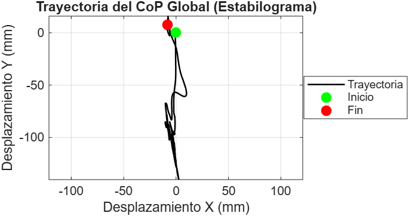
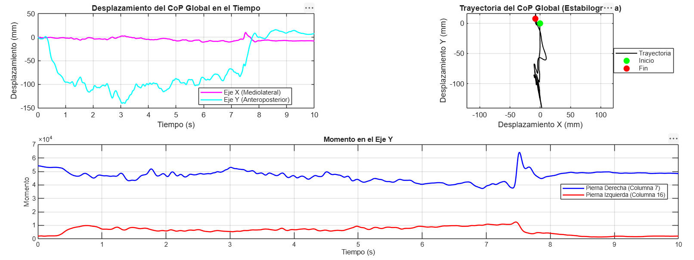

# Effect of an Ankle Brace on Lower-Limb sEMG, Kinematics and Kinetics

Multimodal biomechanical analysis comparing an **injured subject** (history of ankle injury) with a **healthy control**, with (**CT**) and without (**ST**) an ankle brace, during **heel raises (EP)** and **vertical jumps (SV)**. Synchronized **surface EMG**, **Vicon motion capture** and **force-plate** data are processed end to end in MATLAB.

Final project — *Biomechanics Lab*, Universidad de Monterrey (UDEM).

## Subjects

Data are pseudonymized: **`INJ`** = injured subject, **`CTRL`** = healthy control. Raw recordings are not distributed.

## Signals and protocol

| Modality | Details |
|---|---|
| sEMG | 6 channels at 2 kHz — bilateral tibialis anterior (TA), soleus (SL), gastrocnemius (GR) |
| Kinematics | Vicon full-body marker set, ankle-centred analysis |
| Kinetics | Force plates: vertical force (Fz), center of pressure (CoP), load distribution |
| Tasks | Heel raise with isometric hold (EP), vertical jump (SV), rest (RP); 3 trials per condition |

## Processing pipeline

| Stage | Implementation | Rationale |
|---|---|---|
| EMG band-pass | 4th-order Butterworth 20–450 Hz, `filtfilt` (`filterEMG_BP`) | Removes motion artefact (< 20 Hz) and high-frequency noise; zero-phase keeps onset timing |
| Linear envelope | Full-wave rectification + low-pass 6 Hz (EP/RP) or 12 Hz (SV) (`GetLinearEnvelope`) | Faster cut-off for the explosive jump task |
| Amplitude normalization | Per-trial 99th-percentile peak (`NormalizeEMGPk`) | No MVC available; percentile instead of max is robust to isolated spikes |
| Phase detection | Automatic take-off / touchdown from summed force-plate Fz (`DetectJumpPhases`) | Event-locked windows (e.g. first 250 ms of landing) |
| Co-contraction | Falconer & Winter CCI, TA vs. triceps surae (`GetCoContractionEP`, `GetSVCoContraction`) | Joint-stiffening strategy indicator |
| Kinematic gaps | Correlation-selected predictors + linear regression (`findPredictors`, `trainMarkers`, `imputateData`) | Recover occluded markers before computing angles |
| Kinematic filtering | Butterworth low-pass 6 Hz, zero-lag | Standard cut-off for human movement |
| Ankle variables | 3D dorsi/plantarflexion, inversion/eversion proxy, angular velocity/acceleration, jump height, landing drift | Clinically relevant ankle-stability metrics |
| Kinetic filtering | Butterworth low-pass 10 Hz (EP) / 50 Hz (SV), zero-lag (`FilterCineticData`) | Higher cut-off preserves the landing impact transient |
| Kinetics | Fz ensemble medians, CoP AP/ML sway, inter-limb symmetry | Load sharing and balance |
| Statistics | Cohen's d (intra- and inter-subject), Wilcoxon rank-sum, t-tests | Effect sizes are the main outcome given n = 3 trials |

## Example results

Selected effect sizes (Cohen's d, jump task — full tables in [`results/tables`](results/tables)):

| Comparison | Variable | d |
|---|---|---|
| Injured, CT vs. ST | Left triceps surae peak activation | 1.56 (very large) |
| Injured vs. control | Right gastrocnemius activation | −4.87 (very large) |
| Injured vs. control | Left triceps surae activation | 4.37 (very large) |
| Injured vs. control | Landing CCI (left / right) | −0.59 / −0.64 (medium) |

<p align="center">
  
  
</p>

## Repository structure

```
src/            main analysis scripts: EMGDataEP/SV, CinematicDataEP/SV, CineticDataEP, GetAnimations
functions/      reusable functions: emg/, kinematics/, kinetics/
dev/            test scripts used while building each function
results/        example figures, kinematic summary tables and statistics tables (.csv / .xlsx)
```

## How to run

MATLAB R2023b+ with Signal Processing and Statistics & Machine Learning Toolboxes. Add `functions/` to the path, put the recordings under `InputData/{Injured,Control}/{EMG,Cinetica,Vicon}/` (not included: personal data), and run the scripts in `src/`.

## Limitations and known issues

- **n = 2 subjects, 3 trials per condition**: results are a case study. With 3 vs. 3 trials, a two-sided Wilcoxon rank-sum test cannot go below p = 0.1, so effect sizes, not p-values, are the meaningful output.
- Normalization to the task peak (not MVC) prevents absolute comparisons of activation between subjects.
- In `results/tables/Intra_Sujeto_SV.csv` and `Inter_Sujeto_SV.csv`, the `CTRL` subject's left and right values are identical, which points to a channel-mapping bug for that subject in the jump analysis. Those rows should be recomputed before drawing side-specific conclusions.

## Authors

Diego Adrián Castro Ovalle and team — Biomedical Engineering, UDEM.
